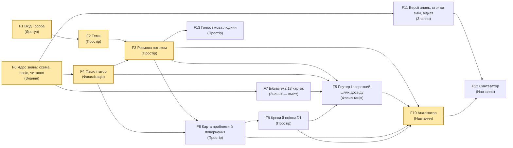

# ThinkHow — функції (M4) і walking skeleton

Статус: M4 СХВАЛЕНО власником 2026-10-18 (master-critic PASS на ред. 3); додано F13 «Голос» за вимогою власника (окремий огляд critic — PASS).
Спирається на: `.engine/architecture/domain-map.md` (M1, схвалено), `.engine/architecture/architecture-map.md`
(M2 схвалено; M3 — на огляді власника), `.engine/goals.md` v3, ADR 0001–0002.

## Простими словами

Продукт розбито на **13 функцій**. Кожна належить одній частині з domain map і дає щось видиме чи
перевірне. Будуємо їх за стрілками на діаграмі: функцію починаємо, лише коли готове все, від чого
вона залежить.

Першим іде **walking skeleton** — найтонший наскрізний ланцюжок (виділений на діаграмі).
- Людина входить через Google.
- Створює тему і пише одну репліку.
- Модель Pro в ЄС веде її за **однією** карткою і відповідає потоком.
- Розмова й карта записуються файлами в Cloud Storage.
- Нічне завдання навчання читає цю розмову і пише одне спостереження.

Усе це розгорнуто в Cloud Run (`europe-west3`) за IAP. Ланцюжок доводить, що всі частини архітектури
стикуються: вхід, файли, Gemini, потік, друге завдання з правом лише читати теки людей. Далі кожна
функція тільки «наростає» на перевірений кістяк.

## Feature DAG

Жовтим — функції, з яких walking skeleton бере **найтоншу частину** (не всю функцію): F1, F2, F3, F4,
F6, F10. Стрілки F5/F8/F9 → F10 — це повні сигнали аналізатора; тонка частина F10 для кістяка їх не
потребує (див. нижче). Циклів немає.

## Walking skeleton (M5 — будується через task board, не в цій розмові)

Найтонший наскрізний ланцюжок; кожен пункт — найменша частина своєї функції:

| Частина | Що саме в кістяку | Що доводить |
|---|---|---|
| F1 | IAP на Cloud Run; `CurrentUser` із підписаного заголовка; власник — email у налаштуваннях; локальний режим із фіксованою особою | PR-04: запрошений Gmail входить, email перевірено, потік SSE проходить крізь IAP, репліка, відправлена після закінчення сесії IAP, не губиться |
| F2 | створити одну тему, відкрити її; папка `users/<id>/<тема>/`; тест «чужа тема недоступна» | G4; PR-07: файли пишуться й читаються з Cloud Run |
| F6 | схема картки і запису пам'яті (pydantic), одна картка (Pre-mortem, українською), команда `seed` створює ревізію 1 (пам'ять порожня) | посів Знань одним записувачем; читання чинної ревізії разом із пам'яттю |
| F4 | один виклик Gemini (`gemini-4-argon` на `eu` — за PoC 101) за карткою: поле `reply` потоком + структуроване оновлення (фаза, зміни карти) | PR-01, PR-02 на реальному розгортанні |
| F3 | репліка → `conversation.md` → відповідь потоком → `conversation.md` + `map.json`; репліки з номерами (якір на сторінці); кнопка вимкнена до кінця потоку; «спробуйте ще раз»; кнопка «завершити» (позначка в `conversation.md`) | порядок записів M2; одна задача — один файл |
| F10 | Cloud Run Job `analyze` (той самий образ) читає одну закриту розмову, **одним викликом Gemini** робить одне спостереження з посиланням на якір репліки і пише його в `system/learning/` | друге завдання; право лише читати `users`; доступ завдання до Vertex; Cloud Scheduler запускає |

Умова старту: PoC 101 пройдено, або власник письмово прийняв ризик (Art. 1). Розгортання (IAP,
OAuth-клієнт «External», bucket-и, Job, Scheduler) робить власник за інструкцією — це його дія.

Skeleton пройшов → архітектура перевірена (`SKELETON_VERIFIED` у журналі); не пройшов → premise
`falsified`, повернення до M2/M3 (Art. 8).

## Функції

| # | Функція | Частина (M1) | Що дає | Цілі | Залежить від |
|---|---|---|---|---|---|
| F1 | Вхід і особа | Доступ | вхід Google-акаунтом лише для запрошених; `CurrentUser`; власник; локальний режим (не стартує в Cloud Run) | G4, C3, N2 | — |
| F2 | Теми | Простір мислення | створити / перелічити / відкрити тему; папка теми; власник читає всі теми; email поруч з id | G2, G4 | F1 |
| F3 | Розмова потоком | Простір мислення | репліка й відповідь потоком; `conversation.md`; репліки з номерами (якір — щоб висновок міг послатися на місце, G6); закриття сесії (кнопка або 24 год тиші); «спробуйте ще раз»; сторінка розмови | G2, G6, P2 | F2, F4 |
| F4 | Фасилітатор | Фасилітація | ведення по фазах картки, одне питання, без готових відповідей; структуроване оновлення (фаза, зміни карти, «час змінити метод»); план Б, якщо PoC 101 скаже | G1, G5, N1, P4 | F6 |
| F5 | Роутер і зворотний шлях досвіду | Фасилітація | профіль проблеми (8 вимірів), 2–3 моделі з поясненням, вибір людини, «інший метод»; `routing.json` з ревізією Знань; **роутер і фасилітатор враховують результати кроків людини (`steps.json`, F9) і записи пам'яті досвіду (порожні до F12)** — замикає G3 «в цій і в наступних проблемах» | G1, G3 | F3, F4, F7, F9 |
| F6 | Ядро знань | Знання | схема картки (половина роутера + половина фасилітатора) і **запису пам'яті досвіду**; посів ревізії 1 командою `seed`; чинний стан (ревізія `rev`/`n`); читання для фасилітації **включно з пам'яттю** (порожньо після `seed`) | G1, G3 | — |
| F7 | Бібліотека 18 карток | Знання (вміст) | 18 стартових карток українською за схемою F6 (шортлист research 01 L1083–1106), без торговельних марок; перевірка схемою | G1, G5 | F6 |
| F8 | Карта проблеми й повернення | Простір мислення | `map.json`: розглянуте, відкинуте з причиною, чого бракує, сліпі плями, емоції свої й іншої сторони, обраний крок і «що мало б статися, щоб передумати», незавершений прохід; показ при поверненні; наздоганяння карти | G1, G2, G5 | F3, F4 |
| F9 | Кроки й оцінки D1 | Простір мислення | «чи стало ясніше?» наприкінці сесії (або при поверненні); «як вийшов крок?»; «чи врахував це розбір?»; `steps.json`; оцінки видно на сторінці теми (власник бачить їх у всіх темах через F2 — так перевіряється D1) | D1, G3 | F8 |
| F10 | Аналізатор | Навчання | нічне завдання: закриті сесії й нові результати → спостереження з посиланнями на якорі реплік (власник відкриває місце — G6), credit assignment; власник бачить спостереження | G3, G6 | F3, F5, F8, F9 (тонка частина для кістяка — лише F3) |
| F11 | Версії знань, стрічка змін, відкат | Знання | нові версії карток і пам'яті через перевірку версії (повнота, без подробиць людей, бюджет розміру); `changes/<rev>`; стрічка змін для власника; відкат `rollbacks/<n>` | G3, G6, G4 | F6 |
| F13 | Голос і мова людини | Простір мислення (мова — у профілі людини) | людина обирає свою мову при першому вході (змінює в профілі; `profile.json`); мікрофон у полі введення: запис → `gemini-3.5-transcribe` (Vertex `eu`, ADR-0005) закріпленою мовою, запис до 15 хв одним запитом → текст у полі, людина править і надсилає; запис лишається на сторінці до появи тексту (можна повторити); фасилітатор за замовчуванням відповідає мовою людини | C4, P2 | F3 |
| F12 | Синтезатор | Навчання | тижневе завдання: спостереження всіх людей → висновки → нові версії пам'яті й карток через F11; не повторює відкочене; вхід обмежений (вікно тижнів або позначка «спожито»); позначка тижня наприкінці | G3, G6 | F10, F11 |

Кожна функція має одну головну частину domain map; дві торкаються сусідньої за дозволеними
стрілками M3: **F8** розширює структуроване оновлення фасилітатора (F4) полями карти; **F5** включає
запис `routing.json` і читання `steps.json` з інших тем людини — це код `workspace`. Будуючи F5,
можна йти «спершу роутер» (йому досить F4 і F7), а зворотний шлях досвіду — коли готова F9. **F13** передає мову людини фасилітатору
значенням — щоб він за замовчуванням відповідав нею. Сторінки (`web`) — частина тієї функції, якій вони
служать; окремої «адмінки» немає: стрічка змін і відкат — у F11, перегляд спостережень — у F10,
читання всіх тем власником — у F2.

**Маршрути між картками** (domain map, «Знання») окремою функцією не будуються: фасилітатор пропонує
наступну картку сам. Якщо власник погодить знахідку simplifier-а `F-5c9e6ac2`, «що добре йде після
цієї картки» — просто поле картки у F7; інакше — відкладено, доки синтезатор не почне їх виводити.

## Порядок будування (DAG)

1. Walking skeleton (тонкі частини F1, F2, F6, F4, F3, F10).
2. Довести F1, F2, F6, F4, F3 до повних.
3. F7 (18 карток), F8 (карта) і F13 (голос) — паралельно; F13 збудовано задачею 106 без задачі 104
   (ADR-0005: запис до 15 хв — одним запитом).
4. F9 (кроки й оцінки), потім F5 (роутер і зворотний шлях досвіду — читає `steps.json` і пам'ять).
5. F11 (версії, стрічка, відкат), F10 повна.
6. F12 (синтезатор) — після цього система вчиться сама.

D1 («більше ніж одна людина… і про них є оцінки») стає досяжним після кроку 4; G3 повністю — після 6.

## Розглянуто й відкинуто

- **Окрема функція «консоль власника».** Охоплювала б три частини (Знання, Навчання, Простір) —
  фіча на кілька контекстів. Натомість кожен вигляд для власника — у функції, чиї дані він показує.
- **Роутер у кістяку.** Кістяк доводить, що архітектура стикується; вибір методу не додає нового
  контейнера чи сховища — достатньо однієї фіксованої картки.
- **18 карток у кістяку.** Вміст не перевіряє архітектуру; одна картка доводить схему і посів.
- **Без завдання навчання в кістяку.** Тоді друге завдання (Cloud Run Job), право лише читати теки
  людей і Cloud Scheduler вперше зустрілися б аж у F10 — архітектурний ризик відкладено. Тонке
  «прочитати розмову → записати спостереження» коштує мало.

## Звірка з цілями
- служить: C4 і P2 (F13 — голос мовою людини), G1 (F4, F5, F7, F8), G2 (F2, F3, F8), G3 (F5, F9–F12), G4 (F1, F2, F11), G5 (F4, F7, F8),
  G6 (F10–F12), D1 (F9)
- вибір між варіантами розв'язав: склад кістяка — правило walking skeleton (найтонший ланцюжок через
  усі контейнери M2); порядок — залежності; принципи P1–P4 не розрізняють варіанти розбиття
- не-цілі й обмеження: N1 — у F4; N2 — F1 (лише запрошені); N3 — нічого не будуємо; C1 — кістяк
  розгортається в `europe-west3`; C3 — F1; C4 — F4 відповідає мовою людини
