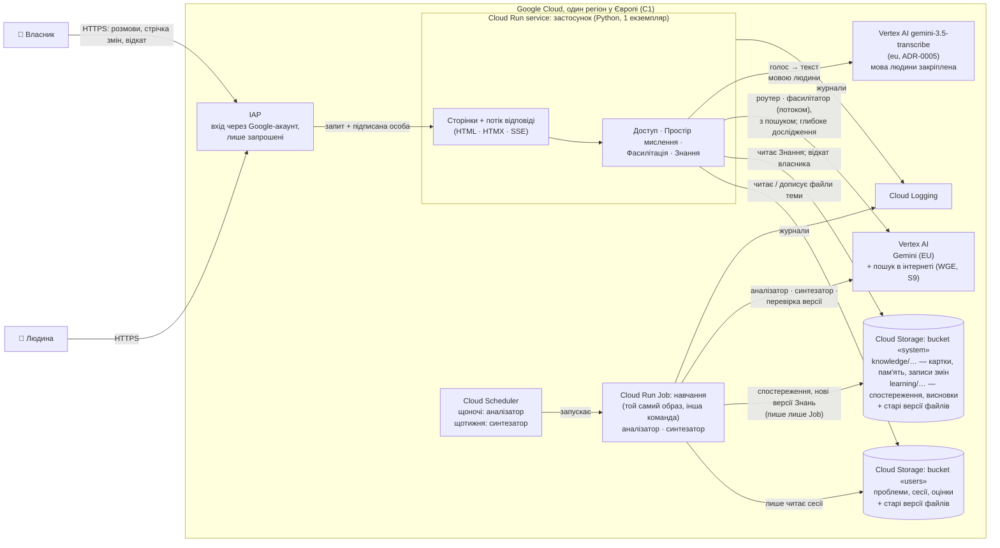
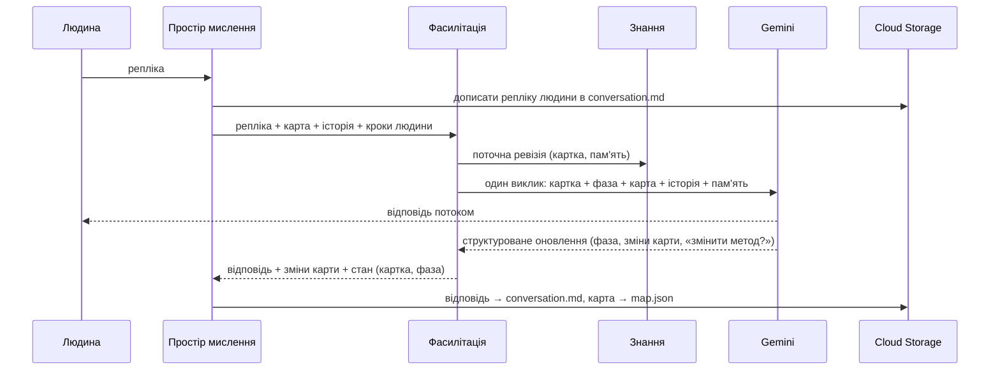
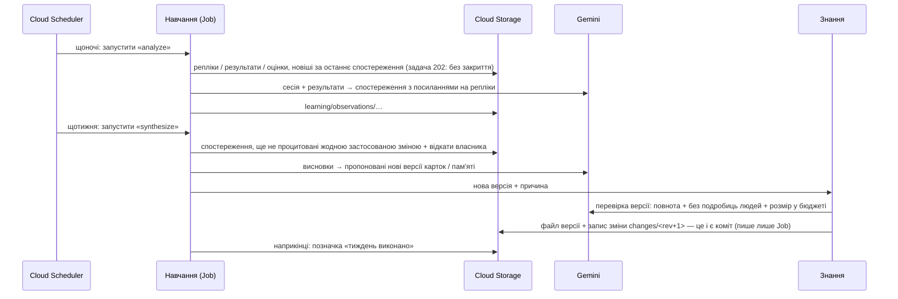
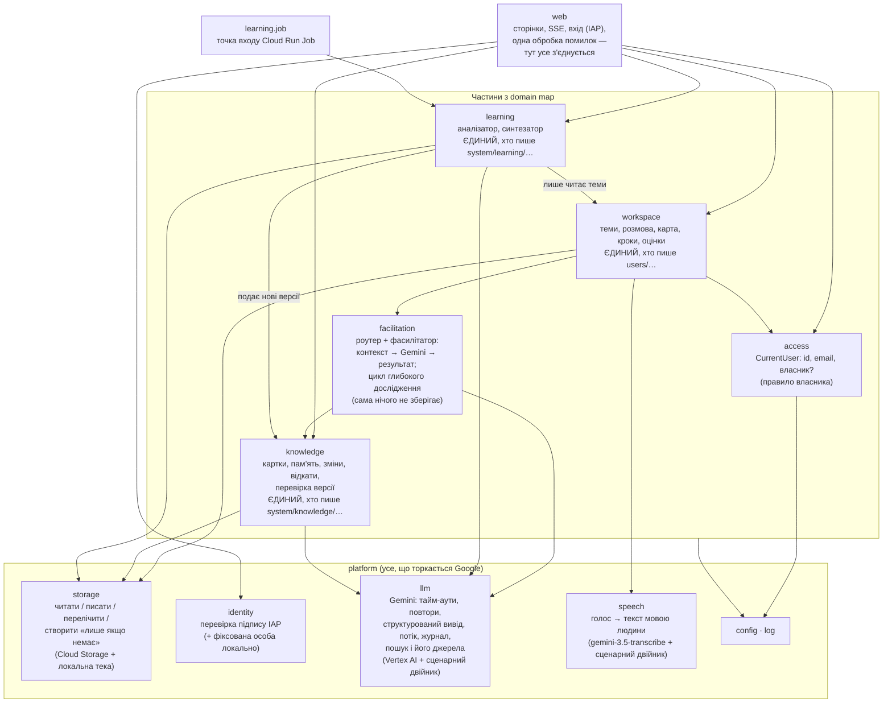

# Architecture map — ThinkHow

Статус: M2 (system design) СХВАЛЕНО власником 2026-10-18 (редакція 8, master-critic PASS); редакція 9 — додано S8 «Голос» за вимогою власника (master-critic, окремий огляд); редакція 10 — додано S9 «Дослідження в розмові» (задача 303, ADR-0006). ADR: `docs/adr/0001-files-in-cloud-storage.md`, `docs/adr/0002-gemini-pro-in-eu.md`. Частина M3 (будова коду) — нижче.
Спирається на: `.engine/architecture/domain-map.md` (M1, схвалено), `.engine/goals.md` v3.
Playbook: `.claude/references/system-design.md` — §0 First-Question Gate, §1 boring defaults,
§2.8 Monolith / Microservices / Serverless, §2.1 (чому без бази), §2.5 Idempotency, §2.7
Timeouts + Retry з backoff, §2.10 Structured Logging (без Distributed Tracing), §4 anti-patterns
2, 9, 10, 11, 12.

## Масштаб, під який проєктуємо

- Люди: власник + близьке коло, 2–10; за 12–18 місяців — до ~20 (N2).
- Навантаження: ≤50 сесій на тиждень, сесія 20–60 реплік (оцінка архітектора; P2 — глибина) → ≤3 000 викликів моделі на
  тиждень на розмови + десятки на навчання. Менше одного запиту на хвилину.
- Дані: текст сесій — мегабайти на рік; знання — сотні файлів.
- Гроші: кредити Google (Q2); головна стаття — модель.
- Що справді обмежує: якість і затримка моделі, ціна токенів. Не пропускна здатність.

За §0 жодна проблема масштабу не існує й не з'явиться за прогнозу → «нудні» варіанти (§1).

## Простими словами

- **Один застосунок у Cloud Run** (C1), в одному європейському регіоні, з одним екземпляром
  (заради ціни, не заради правильності). У ньому всі п'ять частин з domain map. Той самий код
  запускається ще й як **завдання навчання** (Cloud Run Job) — уночі й раз на тиждень.
- **Файли** (рішення власника) лежать у **Cloud Storage** — «диску» Google, що не стирається, як
  власний диск Cloud Run. Сесії, карти проблем, кроки, оцінки, картки, пам'ять досвіду, висновки —
  усе звичайні файли (JSON / YAML / Markdown). У кожного користувача — своя папка; у ній — папка
  на кожну тему (проблему); у папці теми — **окремі файли під окремі задачі** (розмова, карта, кроки
  й оцінки). **Кожен файл пише лише одна задача**, і одна задача працює по черзі — тож нічого не
  треба «узгоджувати». (Рідкісне подвійне надсилання з двох вкладок перезапише файл, але
  перезаписане лишається в старих версіях.) Старі версії файлів зберігаються — захист від випадкового
  перезапису.
- **Вхід** — **IAP**, «охоронець» Google перед застосунком: пускає лише Google-акаунти зі
  списку власника (C3, N2). Власного коду входу немає.
- **Модель** — **Gemini через Vertex AI** у тому самому європейському регіоні (C1). Відповідь
  людині з'являється поступово («потоком»).
- **Двигун навчання** — той самий код, запущений як окреме завдання (Cloud Run Job).
  **Cloud Scheduler** («будильник» Google) запускає його щоночі (аналізатор) і щотижня
  (синтезатор).
- **Сторінки** рендерить сам застосунок (HTML + HTMX + потік SSE) — одна мова, одне розгортання.

## Container diagram



## Як іде одна репліка



Один виклик моделі на репліку — premise PR-02, його перевіряє PoC 101. Якщо одного виклику
мало, план Б: другий виклик оновлює карту **після** того, як відповідь уже показано людині, у
тому самому запиті (черга не потрібна). «У тому самому запиті» означає: потік SSE лишається
відкритим, доки не дописано `conversation.md` і `map.json` (і не завершено виклик плану Б) — бо
Cloud Run за оплатою «за запити» не дає процесору працювати після закриття відповіді. Якщо людина
закрила сторінку посеред потоку — її репліка вже збережена, губиться лише відповідь, і «спробуйте
ще раз» її відновлює. Якщо структуроване оновлення прийшло невалідним — повторюється лише воно
(відповідь людина вже бачила). У плані Б карта може відстати на одну репліку, якщо людина закриє
сторінку, поки йде другий виклик; тоді `map.json` записує номер останньої репліки, яку він
врахував, і наступний запит доганяє карту.

На початку сесії (і коли «час змінити метод») перед фасилітатором іде **роутер** — ще один
виклик: профіль (8 вимірів) + 2–3 моделі з поясненням → людина обирає → рішення роутера з
ревізією Знань (пара `rev`, `n`) записується в `routing.json`.

## Як система вчиться (пакетно, Cloud Run Job)



## Рішення M2

| # | Рішення | Двері | Хто вирішує |
|---|---|---|---|
| S1 | Один застосунок у Cloud Run + навчання як Cloud Run Job з того самого образу; будить Cloud Scheduler | two-way* | архітектор (власник бачить) |
| S2 | Файли в Cloud Storage (два bucket-и в ЄС): папка користувача → папка теми → окремі файли під окремі задачі; **кожен файл пише одна задача**; старі версії файлів | one-way | власник (його рішення «файли» і «одна папка — свої файли», 2026-10-18) |
| S3 | Політика: обробка моделлю лише в ЄС (регіональний або `eu` endpoint); конкретні модель і endpoint — за PoC 101: `gemini-4-argon`, `eu` | політика — one-way (Art. 5), модель — two-way | політика — власник зараз; модель — за PoC |
| S4 | Вхід через IAP зі списком Google-акаунтів | two-way | архітектор |
| S5 | Сторінки рендерить сервер (HTML + HTMX + SSE) | two-way | архітектор |
| S6 | Знання: кожна версія — новий файл; кожна застосована зміна — запис `changes/<rev>` (пише лише Job); кожен відкат — окремий файл `rollbacks/<n>` (пише лише власник); стан Знань = пара (останній `rev`, останній `n`) | two-way | архітектор |
| S7 | Без бази, черг, кешу, листів, векторної бази, окремої аналітики, трасування | two-way | архітектор (§0) |
| S8 | Голос: браузер записує → застосунок → `gemini-3.5-transcribe` на Vertex `eu` закріпленою мовою людини (ADR-0005, задача 106) → текст у полі введення, людина править і надсилає; запис до 15 хв — одним запитом | two-way | власник (вимога 2026-10-18); модель — агент за задачею 106 |
| S9 | Дослідження в розмові: Web Grounding for Enterprise у власному потоковому виклику фасилітатора і відповіді «answer» (модель сама вирішує шукати; роутер без інструмента); глибоке — власний цикл «план → пошуки паралельно → звіт» у тому самому запиті, коли людина погодилась; джерела з метаданих, Search suggestions під відповіддю; `research.json` у темі, факти — у карті (ADR-0006, задача 303) — ACCEPTED 2026-10-25 | two-way | власник — дослідження, межа ЄС для пошуку, ризик умов Google «Б» (задача 303); спосіб — архітектор |

\* Один образ, два способи запуску: злити навчання назад у застосунок чи винести ще щось — дешево.

### S1. Один застосунок + навчання як Cloud Run Job з того самого образу
- **Чому:** §2.8 «Monolith (the default)… Microservices (guilty until proven necessary)»: одна
  людина й агенти, немає різних профілів навантаження. Один код, один образ, одне розгортання
  коду; навчання — той самий образ, запущений командою `analyze` чи `synthesize` як Cloud Run
  Job. Job не має ліміту часу HTTP-запиту (у Cloud Scheduler він 3 хв за замовчуванням і не
  більше 30 хв), сама повторює впалі спроби, і їй не потрібна внутрішня адреса, яку довелося б
  ховати за IAP. `max-instances=1` у застосунку — лише налаштування ціни й холодного старту, **не**
  гарантія правильності: один екземпляр обробляє багато запитів одночасно, а Google допускає
  коротке перевищення ліміту. Правильність записів тримає S2.
- **Повтори без задвоєнь і без втрат (§2.5 idempotency):** аналізатор бере лише репліки,
  результати чи оцінки, новіші за останнє спостереження (задача 202). Синтезатор бере лише
  спостереження, які ще не процитувала жодна застосована зміна (кожна зміна перелічує свої
  спостереження); позначку «тиждень виконано» пише **наприкінці**. Тож упалий прогін при повторі
  просто доробляє роботу, а не виходить мовчки.
- **Розглянуто й відкинуто:**
  - *Окремі сервіси* (Фасилітація, Навчання). Мережа, кілька розгортань, узгодженість між ними —
    витрати розподіленої системи без вигоди (§4 anti-patterns 2, 11).
  - *Навчання всередині застосунку* (Cloud Scheduler кличе внутрішню адресу). На один ресурс
    менше, але ліміт 30 хв на прогін, внутрішня адреса, яку треба провести повз IAP, і обірваний
    прогін при кожному розгортанні. Різниця мала; Job знімає ці три речі без нового коду.
- **Ціна:** коли застосунок «спить» (scale to zero), перший запит після паузи — кілька секунд
  холодного старту. Тримати один екземпляр завжди теплим — кілька десятків доларів на місяць з
  кредитів; вибір — під час розгортання (двосторонні двері).

### S2. Файли в Cloud Storage
- **Чому:** рішення власника «текст пишеться файликами». Власний диск Cloud Run стирається під
  час кожного перезапуску, тому файли — в Cloud Storage того самого регіону.
- **Що тут справді незворотне:** перенести файли пізніше в базу дешево. Незворотне інше —
  Cloud Storage **не вміє змінити кілька файлів разом**. Тому кожне правило, яке мусить триматися,
  живе в одному файлі, і в кожен файл пише лише одна задача (нижче). І дані лежать у ЄС.
- **Два bucket-и:** `users` (проблеми, сесії, оцінки) і `system` (Знання і Навчання). Завдання
  навчання має право лише **читати** `users` — помилка в ньому не зіпсує даних людей. Права в Cloud
  Storage даються на bucket, тому межа — два bucket-и, а не тека.
- **Одне правило: кожен файл пише одна задача.** Тоді двох одночасних записів в один файл не
  буває, і жодних «умовних записів» чи блокувань не потрібно:

  | Файл (папка теми `users/<людина>/<тема>/`) | Хто пише |
  |---|---|
  | `conversation.md` — розмова (репліки дописуються по черзі) | розмова: репліка людини, потім відповідь |
  | `map.json` — карта проблеми (+ на якій фазі обраної картки зупинились; обраний людиною крок) | задача «відповідь на репліку» |
  | `routing.json` — рішення роутера (яка картка зараз чинна — з останнього рішення) | задача «вибір методу» |
  | `steps.json` — результати кроків і оцінки (сам крок обирається в розмові і лежить у `map.json`) | людина, коли відповідає на питання |
  | `users/<людина>/profile.json` — email і мова людини | задача «профіль» (перший вхід, зміна мови) |

  | Файл (bucket `system`) | Хто пише |
  |---|---|
  | `knowledge/cards/…`, `knowledge/memory/…`, `knowledge/changes/<rev>.json` | лише завдання навчання (один прогін за раз) |
  | `knowledge/rollbacks/<n>.json` — відкати, номери по черзі, «лише якщо ще немає» | лише власник (через застосунок) |
  | `learning/…` — спостереження, висновки | лише завдання навчання |

  Завдання навчання папки людей лише **читає**. Чинні знання = останній запис змін мінус відкати
  власника; відкат діє одразу, а наступний прогін навчання його бачить і не повторює. Одна людина
  в одній розмові пише по черзі; кнопка «надіслати» вимкнена, доки потік відповіді не закрився
  (тобто доки відповідь не дописано в `conversation.md`). Рідкісне
  подвійне надсилання (дві вкладки, «спробуйте ще раз», поки сервер ще дописує) — останній запис
  перемагає; перезаписане лишається в старих версіях файлу. Це прийнятий залишковий ризик.
- **Репліка:** спершу дописується `conversation.md`, потім `map.json`. Якщо модель не відповіла —
  «спробуйте ще раз» генерує відповідь на вже збережену репліку людини, а не дописує її вдруге.
- Пишемо через клієнтську бібліотеку Cloud Storage (а не «змонтовану теку») — так надійніше
  читати й дописувати файли з Cloud Run; деталі — M3.
- **Старі версії файлів** (і «м'яке видалення» Cloud Storage — 7 днів) — захист від перезапису,
  не резервна копія; див. «Надійність і нагляд». Щоб старі версії не росли без меж, правило
  життєвого циклу тримає їх обмежений час (число — під час розгортання).
- **Розкладка** — таблиці вище; точні імена й формат — M3. Сесії однієї теми — розділи в
  `conversation.md` (або окремі файли сесій у папці теми — вибір M3).
- **Розглянуто й відкинуто:**
  - *Реляційна база (Cloud SQL).* «Нудний» вибір за §1, але власник обрав файли; за цього
    масштабу (сотні файлів) перелік і читання файлів закривають усі запити Навчання. Якщо колись
    знадобляться довільні запити по тисячах сесій — додати базу можна поруч (двосторонні двері
    для даних, бо файли легко імпортувати).
  - *Firestore.* Не файли (рішення власника), і нічого не дає на цьому масштабі.
  - *Один файл на тему з усім разом.* Відкинуто власником: різні задачі пишуть різне, і в одному
    файлі вони б заважали одна одній.
  - *Умовні записи («заміни, лише якщо ніхто не змінив») для спільних файлів.* Відкинуто: при
    правилі «кожен файл пише одна задача» спільних файлів немає.
  - *Filestore (мережевий диск NFS з блокуваннями).* Справжні файли з блокуваннями, але мінімальний
    обсяг коштує на порядки більше, ніж потрібно для мегабайтів даних (Q2).

### S3. Модель — Gemini через Vertex AI в ЄС
- **Чому:** C1 (моделі Google; кредити Google йдуть на Vertex AI). Регіональний endpoint тримає
  обробку в ЄС разом із даними.
- **Розглянуто й відкинуто:** *Gemini API з AI Studio* — інші умови обробки даних, без гарантії
  регіону; *`global` endpoint* — за документацією Google дає кращу доступність і менше відмов 429 і
  часто першим отримує нові моделі, але без гарантії, що дані обробляються в ЄС; лише з явного
  дозволу власника. Між ними є `eu` multi-region endpoint (дані лишаються в межах ЄС) — PoC 101
  перевіряє і його. За <1 запиту на хвилину рідкі 429 покривають повтори з backoff.
- **Рішення власника (2026-10-18):** модель класу **Pro з reasoning/thinking** (напр., Gemini 2.5
  Pro або рівноцінна), **не Flash** — Flash власник уже пробував, «для цього йому не вистачає мізків».
  Регіон — `europe-west3` (Франкфурт; `docs/infra.md`), запасний — `eu` multi-region endpoint.
- Різні виклики можуть іти на різні моделі (швидша для роутера й перевірки версії, сильніша для
  фасилітатора й синтезатора) — вибір за PoC, двосторонні двері. Тут діють P1 і P2 («глибина
  понад стислість», «час на обдумування понад швидкий старт»): швидша модель — лише якщо якість не
  падає, а не заради секунд.

### S4. Вхід — IAP
- IAP вмикається прямо на Cloud Run service (без окремого балансувальника — без місячної плати
  за нього). Нуль власного коду входу; список дозволених акаунтів — у налаштуваннях Google Cloud (N2).
  Для звичайних Gmail-акаунтів (люди поза організацією Google Workspace) IAP потребує власного
  OAuth-клієнта з типом «External» — це налаштування, не код.
- **Хто що бачить (G4) — одне правило:** особа людини береться лише з підписаного заголовка IAP,
  ніколи з адреси сторінки чи форми; файли людини лежать під її сталим ідентифікатором від IAP (не
  під email — щоб заміна IAP пізніше лишилась зміною одного шару); будь-який доступ до `users/<id>/…` іде через це правило;
  власник — один email у налаштуваннях і бачить усе (G4 v2). Розділ навчання (`learning/…` —
  спостереження з подробицями людей і цитатами) і стрічка змін — лише для власника. Деталі — M3.
- Відкинуто: *Firebase Auth / Identity Platform* — більше коду без потреби; *власний OAuth* —
  свій код безпеки. Заміна IAP пізніше — зміна одного шару.
- PR-04 (запрошені звичайні Gmail-акаунти входять, застосунок отримує перевірений email, потік
  SSE проходить крізь IAP) — перевіряє walking skeleton. Увімкнення IAP і створення OAuth-клієнта
  «External» у проєкті без організації робить власник у консолі Google Cloud — крок у його
  інструкції розгортання. Skeleton перевіряє ще й те, що репліка, відправлена після того, як сесія
  входу IAP закінчилась, не губиться (довгі сесії — P1, P2).

### S5. Сторінки рендерить сервер
- HTML з сервера, HTMX оновлює шматки сторінки, SSE показує відповідь потоком. Одна мова
  (Python), одне розгортання.
- Відкинуто: *окремий React-застосунок + API* — друга мова, збірка й розгортання для одного типу
  клієнта.

### S6. Ревізії Знань
- Кожна версія картки чи запису пам'яті — новий незмінний файл.
- **Запис зміни = коміт.** Кожна застосована зміна — один файл `knowledge/changes/<rev>.json`
  (номер з нулями попереду). У ньому: що змінилось, чому, посилання на висновки й спостереження, і
  повний перелік чинних версій. Пише лише завдання навчання, номери по порядку, а стрічка змін не
  може розійтися з тим, що чинне: стрічка і є історія змін. Файл `<rev+1>` створюється «лише якщо
  ще немає» — це не «умовний запис спільного файлу», а запобіжник від двох прогонів навчання, що
  випадково перекрились (Cloud Run цього сам не забороняє).
- **Відкат** — окремий файл `knowledge/rollbacks/<n>.json` (номери по черзі), який пише лише
  власник; у ньому названо точні версії, які він скасовує (щоб нові версії, записані після нього,
  не відкочувались). Чинні знання = останній запис змін мінус відкати. Відкат діє одразу; наступний
  прогін навчання бачить його і не пропонує те саме знову.
- **Ревізія Знань** (M1: «з одним номером можна відтворити, що бачила модель») за правилом «один
  файл — один, хто пише» — це **пара** (останній `rev`, останній номер відкату `n`). Рішення роутера
  і кожен рядок журналу виклику моделі записують цю пару.
- **Бюджет розміру** — третя умова перевірки версії (крім повноти й «без подробиць людей»): нова
  версія відхиляється («відхилено перевіркою: перевищено бюджет», видно в стрічці), якщо Знання, які
  модель читає за один виклик, не вміщуються в контекст моделі із запасом на розмову. Межа технічна
  (вікно контексту обраної моделі), не про швидкість чи ціну: за P4 (запит 005, `PROVISIONAL`) час і
  ціну лише записуємо. Так автоматичне навчання змушене зливати й замінювати записи, а не лише
  додавати.
- Стартові 18 карток лежать у репозиторії і при першому запуску стають ревізією 1. Далі
  джерело правди — файли в Cloud Storage, не репозиторій (бо система вчиться сама).
- Файли версій незмінні, тож застосунок може тримати прочитані в пам'яті процесу без ризику
  застарілості — це не кеш у сенсі §2.3 (S7 цього не забороняє); перевіряється лише, чи з'явився новіший запис змін чи відкат.
- Відкинуто: *картки лише в репозиторії, версія = commit SHA* — несумісно з автоматичним
  навчанням (застосунок не комітить у git).

### S8. Голос (вимога власника 2026-10-18)
- **Вимога власника:** людина може говорити голосом; мову вона обирає сама наперед, мова за нею
  закріплюється, і розпізнавання працює цією мовою.
- **Як:** людина натискає мікрофон, говорить; браузер записує звук (MediaRecorder) і віддає його
  застосунку; застосунок через Vertex AI (модель **`gemini-3.5-transcribe`**, регіон `eu`, українська —
  Supported; ADR-0005, задача 106 — замість Chirp 3) розпізнає **закріпленою за людиною мовою** (`language_codes`). Текст з'являється в полі введення;
  людина виправляє й надсилає, як звичайну репліку. Поки людина чекає текст, запис лишається на
  сторінці — можна повторити.
- **Мова людини** обирається при першому вході (змінити — у профілі) і лежить у
  `users/<людина>/profile.json`; нею ж за замовчуванням відповідає фасилітатор (C4).
- **Звук як дані ThinkHow не зберігає** — технічний вибір архітектора, не вимога власника: записом
  розмови є текст, звук ні для чого не потрібен. (Тимчасові копії в Google — кеш Vertex AI, тимчасовий
  файл для довгого запису — цьому не суперечать; P3: вдосконалення понад приватність.)
- **Довгі диктовки.** (Поправка задачі 106, ADR-0005.) Запис до 15 хв іде одним запитом: 14.7 хв мови — 12–14 с
  до тексту (spike `.engine/artifacts/spikes/voice-stt-2026-10-23/`); браузер пише 64 кбіт/с і зупиняється сам на
  14.5 хв. Чотири способи, які мала порівняти задача 104 (потік і пакет Chirp 3, Gemini з аудіо, шматки ≤55 с),
  більше не потрібні; Chirp 3 не виміряно — API Speech-to-Text у проєкті вимкнений.
- **Розглянуто й відкинуто:**
  - *Розпізнавання в браузері (Web Speech API).* Безплатно й просто, але в Chrome звук іде на сервери
    Google без гарантії ЄС (S3), а в інших браузерах працює погано чи ніяк.
  - *Розпізнавання наживо постійним з'єднанням браузер ↔ застосунок.* Таке з'єднання крізь IAP не
    перевірене — зайва складність для старту (варіант 4 дає майже те саме звичайними запитами).

### S9. Дослідження в розмові (задача 303, поправка 2026-10-25; ADR-0006)
**ACCEPTED 2026-10-25.** Умови Google для відповідей з пошуком (§20(k)(i) Service Specific Terms) забороняють
частину цього креслення; власник (задача 303, питання 3) обрав «Б» — пошук Google, ризик умов на його рахунку (ADR-0006, Status).
- **Вимога власника** (задача 303, 2026-10-24): «нам треба туди внести дослідження»; «ці дослідження мали би бути
  якось чи частиною продукту»; «нас цікавлять факти. Якщо факт є готова відповідь, значить тоді готова відповідь
  можна дати»; глибина — «має визначитись в розмові з людиною… по потребі». Це G7 і N1 поправки цілей v5
  (`.engine/goals.md` v5, затверджено власником 2026-10-25: «Так, правка до цілей. G7 може бути. І N1 теж може бути»).
- **Межа ЄС для пошуку — слова власника** (2026-10-25, записано в задачі 303): «пошук в інтернеті дозволено; обробка
  запитів у ЄС не потрібна — обмежень немає, варіант обирай сам»; «Це не корпоративний продукт. Це для простої
  людини.» Тому політика S3 «обробка моделлю лише в ЄС» **не стосується пошукових запитів**: їх складає модель із
  розмови, і жоден спосіб шукати в інтернеті на Vertex не має явної гарантії ЄС
  (`.engine/artifacts/spikes/research-google-eu-2026-10-24/README.md`). Сама модель і далі працює на `eu` — правку
  застосовано вузько, лише до пошуку.
- **Як (швидко):** фасилітатор (і відповідь на дію роутера «answer») отримує у **свій же** потоковий виклик Gemini інструмент пошуку — **Web Grounding for
  Enterprise** (`enterprise_web_search`, ADR-0006). Шукати чи ні, вирішує сама модель за правилом інструкції: факт про
  світ, якого людина не знає (ціни, ринок, як роблять інші, правила), — знайти й дати коротко; те, що покаже лише
  реальність, — запропонувати дешевий тест як крок людини; факт про саму людину — питати її. Проба
  (`.engine/artifacts/spikes/research-design-2026-10-25/README.md`): на репліках власника #17, #19, #21 модель шукала
  (2 запити, 2–4 джерела, +10–23 с), на #25 — ні, і час не змінився. Пряме фактичне питання на початку теми роутер
  позначає новою дією «answer» (сам роутер — `generate_json` без інструмента), і відповідь фактом з джерелом дає один
  потоковий виклик з пошуком, без вибору способу думати.
- **Як (глибоко):** коли питання багатогранне (ринок, кілька шляхів), модель у відповіді пропонує глибоке дослідження
  і каже, скільки чекати; коли людина погодилась чи сама попросила — модель ставить у своєму оновленні питання для
  дослідження, коротко каже людині, що почала, і застосунок у **тому самому запиті** виконує власний цикл: план
  підпитань → кілька пошуків паралельно → звіт з джерелами, що закінчується одним питанням до людини (≈2 хв,
  ≈ $0.3–0.4 — проба 24.10). Поки йде цикл, людина бачить, що саме шукають. Потік SSE лишається відкритим
  (`--timeout 3600`, як уже для довгих відповідей).
- **Джерела:** беруться з метаданих відповіді Google (не з тексту моделі), посилання-перенаправлення Google
  розгортаються в справжні адреси сторінок; код дописує їх під відповіддю. **Search suggestions** (чипи Google з
  пошуковими запитами) показуються під відповіддю такими, як прийшли, — це умова Google для WGE.
- **Де лежить:** у теці теми — `research.json` (пише лише `workspace`, як і все в `users/…`): на кожну відповідь з
  пошуком — номер репліки, глибина, пошукові запити, джерела (назва, адреса), Search suggestions, для глибокого —
  звіт. Знайдене модель коротко кладе в карту проблеми пунктом нового типу «факт» — карта йде в кожен виклик, тож
  знайдене пам'ятається і в наступних сесіях (G2), а не лише в історії поточної.
- **Одна репліка з дослідженням:**

  ```mermaid
  sequenceDiagram
      participant P as Людина
      participant W as Простір мислення
      participant F as Фасилітація
      participant G as Gemini (eu) + пошук WGE
      participant S as Cloud Storage
      P->>W: «Як це можна взнати?»
      W->>S: репліка → conversation.md
      W->>F: репліка + карта + історія
      F->>G: виклик роутера чи фасилітатора з інструментом пошуку
      G-->>G: модель сама вирішує: шукати (факт про світ) чи ні
      G-->>P: відповідь потоком — знайдені факти + одне питання
      G-->>F: оновлення (фаза, карта з пунктом «факт», питання для глибокого — якщо людина погодилась)
      opt людина погодилась на глибоке
          F->>G: план підпитань → пошуки паралельно → звіт з джерелами
          F-->>P: що шукаємо зараз; далі звіт і одне питання
      end
      F-->>W: відповідь + джерела (справжні адреси) + Search suggestions
      W->>S: conversation.md, map.json, research.json
  ```
- **Розглянуто й відкинуто:**
  - *Окремий класифікатор «шукати чи ні» перед кожною відповіддю.* Проба: вирішував грубіше (глибину «deep» ставив
    майже завжди; #23, яке покаже лише реальність, назвав фактом про світ) і додавав ще одну частину й +4.4–9.3 с на
    **кожну** репліку. Рішення в тому самому виклику влучило на всіх чотирьох репліках проби (P4, P5).
  - *Gemini Deep Research від Google* (Interactions API). Лише глобальний Gemini API з ключем AI Studio, Preview, до
    20 хв, ~$1–3 за задачу; на Vertex його немає. Власний цикл на тому самому Vertex дає звіт з місцевими джерелами
    за ~2 хв.
  - *Grounding with Google Search* замість WGE — працює так само (ціна та сама), але запити Google тримає в журналах
    до 3 днів; WGE «doesn't log customer data». Різниця в коді — один рядок (ADR-0006).
  - *Глибоке дослідження фоновим завданням* (Cloud Run Job, черга, «відповідь прийде пізніше»). Нова частина системи
    (черга, другий записувач розмови) заради 2 хв, які вміщаються в один запит.

### S7. Чого свідомо НЕ будуємо
База даних, черга, кеш, листи, векторна база, окрема аналітика (BigQuery / ClickHouse /
Langfuse), трасування, окремий сервіс очищення персональних даних. Жодного виміряного сигналу
(§0); кожне додається пізніше без переробки ядра.

## Мова
C4 (кожен веде сесії своєю мовою): мова людини закріплена в `profile.json` (S8) — на неї
налаштоване розпізнавання голосу, нею за замовчуванням відповідає фасилітатор; вміст Знань — однією
мовою (M3 A5).

## Час і закриття сесій
Сесія вважається закритою, якщо її остання репліка старша за 24 години (domain map), або старий файл має
позначку закриття. «Закрито тишею» не записується окремим таймером — це обчислюється з часу останньої
репліки там, де потрібно (у застосунку: межа показу й історії фасилітатора). Кнопки «завершити» немає, і
аналізатор від закриття не залежить: він бере всі репліки теми, новіші за останню проаналізовану, номер якої
видно з назв файлів спостережень `t<a>-t<b>.json` (задача 202).

## Надійність і нагляд
- Кожен виклик моделі — з тайм-аутом і обмеженими повторами з backoff і jitter (§2.7; §4
  anti-patterns 9–10). Якщо модель не відповіла — «спробуйте ще раз»; репліка людини вже
  збережена й не губиться.
- Структуровані журнали в Cloud Logging з ідентифікатором запиту (§2.10). Кожен виклик моделі —
  рядок журналу: модель, токени, затримка, ревізія Знань (пара `rev`, `n`). Текст сесій у журнали
  не пишеться. Журнали теж зберігаються в ЄС (регіон log bucket — налаштування під час
  розгортання; за замовчуванням Google тримає їх `global`).
- **Захист від перезапису, не резервна копія:** старі версії файлів і «м'яке видалення» рятують
  від помилкового перезапису чи видалення файлу, але не від втрати всього проєкту чи bucket-а
  (напр., коли закінчаться кредити — Q2). **Рішення власника (2026-10-18): поки що пропускаємо** —
  обсягу немає; відкладено як `tasks/proposed/103-backup-before-volume.md` (зробити, коли з'явиться
  обсяг або перед кінцем кредитів).

## PoC (Art. 1) — задачі для task board
- **101 — Gemini в ЄС** (`tasks/done/101-poc-gemini-eu/`; зроблено 2026-10-21: `gemini-4-argon` на `eu`, PR-01…PR-03 `verified`): PR-01, PR-02, PR-03 — є в ЄС
  модель, яка за один виклик веде фазу картки без готових відповідей, повертає валідне
  структуроване оновлення. Найризиковіший premise: від нього
  залежить форма головного потоку. Час і ціну PoC лише записує (P4, `PROVISIONAL`); головний критерій — власник читає відповіді.
- Окремий PoC для файлів не потрібен: при правилі «кожен файл пише одна задача» немає
  одночасних записів, а збереження файлів у Cloud Storage — його основна, задокументована властивість.
  Що файли пишуться й читаються з Cloud Run, перевіряє walking skeleton.
- PR-04 (IAP + потік SSE) перевіряє walking skeleton (потрібне розгортання, яке робить власник).
- Walking skeleton (M5) будується лише після PASS 101 або письмового прийняття ризику власником.

## Примітки для M3 і функцій (від master-critic)
- ~~Закриття сесії кнопкою «завершити» — позначка в `conversation.md`~~ — прибрано задачею 202; старі позначки лише читаються.
- Файл спостереження має стале ім'я на (сесія, причина), щоб повтор прогону перезаписував, а не
  задвоював; таймаут завдання навчання задати явно (за замовчуванням Cloud Run — 10 хв).
- Email поруч з ідентифікатором людини (G4: «про кожну сесію відомо, чия вона») — див. M3 A3 (пункт 3).
- Таблиця файлів називає **задачі** («відповідь на репліку», «вибір методу»), а не модулі: за M1
  Фасилітація сама нічого не зберігає — файли пише Простір мислення.
- G4: автоматичні запобіжники — див. M3 A3 (пункт 3).
- Функція навчання: вхід синтезатора має бути обмежений (вікно останніх N тижнів або позначка
  «спожито висновком»), інакше спостереження без застосованої зміни подаються щотижня назавжди.

## Звірка з цілями
- служить: G2 (дані проблем не губляться — S2: кожен файл пише одна задача, старі версії файлів), G3 і G6
  (двигун навчання як Job, ревізії Знань і стрічка змін — S1, S6), G4 (вхід IAP і одне правило
  «хто що бачить» — S4; файли за людиною — S2), G1 і G5 (через PR-02 — якість одного виклику), D1 (оцінки — у файлах проблеми)
- S9 (дослідження): служить G7 і G1 (факти про світ, яких людина не знає, система шукає сама — v5), G2 (знайдене в
  карті й `research.json`), N1 v5 (факт можна дати прямо; рішення лишається за людиною — правила інструкції); межа ЄС
  для пошукових запитів знята словами власника (задача 303), сама модель лишається на `eu` (S3); вибір WGE проти
  Google Search — технічний (однакові ціна й якість; менше даних у журналах Google)
- S8 (голос): служить C4 і P2; межа — S3 (обробка в ЄС; тому відкинуто розпізнавання в браузері);
  спосіб для довгих диктовок вирішує власник за якістю й очікуванням (P4, задача 104); звук як дані не
  зберігаємо — технічний вибір (P3 не страждає: текст лишається)
- вибір між варіантами розв'язав: S2 — рішення власника «файли» (2026-10-18); S3 — C1 («Google у
  Європі») і рішення власника щодо обробки в ЄС (Art. 5); вибір моделі — P1/P2 (якість понад
  швидкість); S6 — рішення
  власника «вчиться автоматично» (джерело правди Знань — Cloud Storage, не git); решта (S1,
  S4, S5, S7) — принципи не розрізняють, вибір технічний (§0 / §1 playbook)
- не-цілі й обмеження: C1 — Cloud Run, Cloud Storage і Gemini в Європі (S1–S3); C3 — вхід через
  Google (S4); C4 — мова людини в `profile.json`, розпізнавання голосу й відповіді нею (S8);
  N2 — лише запрошені, без реєстрації й оплати (S4); Q2 — усе в межах кредитів, головна стаття —
  модель; N1 — забезпечує фасилітатор (M1), системний рівень не зачіпає; N3 — нічого не будуємо

---

# M3 — Будова коду (software architecture)

Статус: M3 СХВАЛЕНО власником 2026-10-18 (редакція 2, master-critic PASS; голос — окремий огляд, PASS).
Playbook: `.claude/references/software-architecture.md` — §0 (не переускладнювати), §1.1
first-question gate, §1.2 boring defaults, §1.3 «малий застосунок», §2.1/2.2/2.4 (чому не clean
architecture), §2.6 modular monolith, §3.2 dependency rule, §3.3 ADP (без циклів), §5.1/5.3
package-by-feature і межі, §6.1 cross-cutting один раз, §9.2/9.3 seams і ручний DI, §10.4/10.5/10.8.

## Простими словами

Код — **один Python-проєкт**, поділений на **папки за частинами з domain map** (Доступ, Простір
мислення, Фасилітація, Знання, Навчання) плюс тонка папка «платформа» з тим, що торкається Google
(файли, Gemini, налаштування, журнали). Усередині кожної папки — прості функції, без зайвих шарів:
код «бере файли → кличе модель → пише файли». Межі між папками строго перевіряються автоматично
лише там, де від них залежить щось важливе: хто має право писати в теки людей (G4) і хто — у Знання
(ваш відкат).

## Component diagram (хто від кого може залежати)



Стрілка = «може імпортувати». Циклів немає (§3.3 ADP). `platform` не імпортує нічого з частин.

## Рішення M3

| # | Рішення | Двері | Хто |
|---|---|---|---|
| A1 | Стиль: modular monolith **за частинами domain map** (package-by-feature), усередині — прості функції (transaction script) | two-way | архітектор |
| A2 | «Порти» (інтерфейс + дві реалізації) лише там, де друга реалізація існує вже: сховище (Cloud Storage / локальна тека для тестів і розробки), модель (Vertex / сценарний двійник для тестів), голос (`gemini-3.5-transcribe` на Vertex / сценарний двійник), особа (IAP / фіксована особа в локальному режимі) | two-way | архітектор |
| A3 | Правило залежностей (діаграма вище) + автоматичні запобіжники лише на 4 речі (нижче) | two-way | архітектор |
| A4 | Наскрізне — один раз: вхід, помилки, журнали, налаштування, виклики моделі | two-way | архітектор |
| A5 | Мова вмісту Знань — українська (картки, пам'ять, стрічка змін) | two-way | архітектор; власник бачить |
| A7 | Дослідження: пошук і його джерела — у `platform.llm`; правила, дія «answer», цикл глибокого дослідження — у `facilitation`; `research.json` пише `workspace`; Search suggestions показує `web` (M2 S9) | two-way | архітектор |
| A6 | Стек: Python 3.12, FastAPI, Jinja2 + HTMX + SSE, `google-genai` (Vertex; і модель, і розпізнавання голосу — ADR-0005), `google-cloud-storage`, pydantic v2, pytest, ruff, mypy, import-linter | two-way* | архітектор |

\* Додавати пакети — дія з дозволу власника (engine-rules); перелік тут — план, ставиться під час
walking skeleton.

### A1. Стиль: папки за частинами, прості функції
- **Чому:** §1.3 «Small CRUD app / internal API → layered or single-module; transaction-script;
  package-by-feature». Наш застосунок малий, але має п'ять частин із різними причинами змін
  (M1) — тому папки за частинами (§5.1, §5.3), а не за технічними шарами. Правил-інваріантів мало
  (одна задача — один файл; перевірка версії Знань), тож багата доменна модель (DDD aggregates,
  repositories) не заробляє місця (§1.2 «Domain modelling: plain data structures + procedural
  service functions»).
- **Розкладка:**
  ```
  src/thinkhow/
    web/           FastAPI-застосунок, маршрути, шаблони, SSE, вхід IAP, обробка помилок — тут усе з'єднується
    access/        CurrentUser (id, email, is_owner) і правило «хто власник»; нічого не пише
    workspace/     теми, conversation.md, map.json, routing.json, steps.json; закриття сесій; оцінки D1
    facilitation/  роутер і фасилітатор: промпти, складання контексту, розбір відповіді моделі
    knowledge/     картки (схема pydantic), пам'ять, changes/rollbacks, чинний стан, перевірка версії
    learning/      аналізатор, синтезатор; job.py — точка входу Cloud Run Job
    platform/      storage.py, llm.py, speech.py, identity.py (IAP), config.py, log.py
  cards/           18 стартових карток (YAML) — посів ревізії 1
  tests/
  ```
- Кожна частина відкриває іншим лише свій `__init__.py` (публічні функції); решта — внутрішнє.
- **Розглянуто й відкинуто:**
  - *Clean / hexagonal скрізь* (use-case interactors, repositories на кожну частину, DTO в обидва
    боки). §2.4: «for a small/medium app… usually more machinery than the problem justifies»;
    §10.5 «lasagna». Інтерфейси без другої реалізації — §10.4 premature abstraction.
  - *Один плаский пакет без частин.* Найпростіше (§5.3 «don't pre-split»), але тоді ніщо не
    гарантує двох речей, від яких залежать ваші рішення: у теки людей пише лише одна частина (G4,
    «одна задача — один файл»), у Знання — лише через перевірку версії (відкат, «без подробиць
    людей»). Папки за частинами майже нічого не коштують, а перевірку роблять можливою.
  - *Шари за технічною роллю* (`routes/`, `services/`, `models/`). §5.1: розкидає кожну зміну по
    всьому дереву.

### A2. Де «порти» заробляють місце (§2.2, §9.2)
| Шов | Реальна реалізація | Друга, що вже існує | Навіщо |
|---|---|---|---|
| `platform.storage` | Cloud Storage (клієнтська бібліотека) | локальна тека | тести без мережі; локальна розробка |
| `platform.llm` | Vertex AI Gemini (`gemini-4-argon`, `eu`; PoC 101) | сценарний двійник (заготовлені відповіді) | детерміновані тести роутера, фасилітатора, навчання |
| `platform.identity` | заголовок IAP (перевірка підпису, `google-auth`) | фіксована особа з налаштувань, лише в локальному режимі | розробка й тести без IAP |
| `platform.speech` | `gemini-3.5-transcribe` на Vertex `eu` з мовою людини (ADR-0005) | сценарний двійник (заготовлений текст) | тести голосової репліки без мережі; Chirp 3 — можлива друга реальна реалізація, якщо власник увімкне Speech-to-Text |
**Локальний режим — один перемикач** вмикає всі двійники разом (локальна тека, сценарна модель,
сценарне розпізнавання голосу, фіксована особа) і **відмовляється стартувати в Cloud Run** (якщо є змінна середовища `K_SERVICE`) —
щоб випадково увімкнений локальний режим не зробив усіх людей однією особою (G4).
Більше портів немає: частини викликають одна одну напряму через публічні функції; залежності
передаються аргументами (ручний DI — §9.3; без DI-контейнера). Час (`now`) передається параметром
туди, де від нього щось залежить (закриття сесії після 24 год).

### A3. Правило залежностей і автоматичні запобіжники
Дозволені залежності — діаграма вище. Автоматично (import-linter + тести, у звичайному прогоні
тестів) перевіряються лише 4 речі, бо від них залежить продукт:
1. **Немає циклів** між частинами (§3.3, §10.6).
2. **Лише `platform` імпортує SDK Google** (`google.cloud.storage`, `google.genai`, `google.cloud.speech`, `google.auth`) —
   фреймворк не розповзається в логіку (§10.7).
3. **Теки людей пише лише `workspace`**, а `facilitation` не імпортує `workspace` і `learning` (вона
   отримує контекст значеннями) — тест + контракт: шляхи `users/…` будує лише `workspace`, з
   ідентифікаторів, які видає сервер (ніколи з тексту адреси як є); тест, що одна людина не може
   прочитати тему іншої, а власник може (G4 v2). Читання «усіх людей» (для власника й навчання) —
   одна названа функція `workspace`; `web` кличе її лише для `is_owner`. Email і мову людини пише
   `workspace` у `profile.json` (задача «профіль», перший вхід і зміна мови), не `access`.
4. **У Знання пише лише `knowledge`** (і лише через перевірку версії); `learning` подає нові версії
   через публічну функцію `knowledge`, а свої файли пише лише в `system/learning/`.

### A4. Наскрізне — один раз (§6.1)
- **Вхід:** один шар у `web` (через `platform.identity`) перевіряє підписаний заголовок IAP і дає кожному запиту
  `CurrentUser(id, email, is_owner)`; власник — один email у налаштуваннях. Жоден маршрут не бере
  особу з адреси чи форми.
- **Помилки:** один обробник у `web` перетворює помилку на зрозумілий шматок сторінки («спробуйте
  ще раз»); недоступність моделі — окремий вид помилки з `platform.llm`.
- **Журнали:** `platform.log` — JSON у stdout з ідентифікатором запиту; `platform.llm` сам пише
  рядок на кожен виклик моделі (модель, токени, затримка, ревізія Знань `rev`/`n`). Текст розмов у
  журнали не пишеться.
- **Налаштування:** `platform.config` — змінні середовища (pydantic-settings): проєкт, регіон,
  bucket-и, модель, email власника, локальний режим.
- **Виклики моделі:** лише через `platform.llm`: тайм-аут, обмежені повтори з backoff і jitter,
  структурований вивід за pydantic-схемою, читання поля `reply` з потоку (PoC 101). Ревізію Знань
  (`rev`, `n`) частини передають у `platform.llm` як непрозорі поля для журналу — `platform` нічого
  не імпортує з частин.
- **Синхронно чи асинхронно:** функції `platform` синхронні (`google-cloud-storage` синхронна);
  FastAPI виконує їх у своєму пулі потоків. Вирішено один раз тут.

### A5. Мова Знань — українська
- Картки, пам'ять досвіду, висновки й стрічка змін пишуться українською: стрічку змін читаєте ви,
  і це ваш єдиний контроль автоматичного навчання (G6, G3). Модель класу Pro розуміє людей будь-якою
  мовою і відповідає мовою людини (C4).
- Відкинуто: *англійська* (моделі трохи краще слухаються англійських інструкцій) — тоді вам
  довелося б читати стрічку змін англійською. PoC 101 веде розмову за українською карткою, зокрема
  30 англійських реплік (картка українською — відповідь англійською); якщо ви побачите, що ведення
  гірше, повернемось — двосторонні двері.
- Наслідок для перевірки версії Знань: «без подробиць людей» перевіряє виклик моделі (переклад
  подробиць дослівний збіг тексту не зловить); збіг тексту — лише доповнення.

### A6. Стек
Python (вже в налаштуваннях двигуна: ruff, mypy, pytest); FastAPI + Jinja2 + HTMX + SSE (M2 S5);
`google-genai` з `vertexai=True` (модель і розпізнавання голосу — ADR-0005); `google-cloud-storage`; pydantic v2 для карток і структурованого
виводу; import-linter для запобіжників A3. Менеджер пакетів — `uv`.

### A7. Дослідження (задача 303, M2 S9, ADR-0006)
- **`platform.llm`** — єдиний, хто вмикає інструмент пошуку (`enterprise_web_search`) і читає `grounding_metadata`:
  виклик із прапорцем «з пошуком» повертає, крім відповіді, значення «що знайдено» — пошукові запити, джерела (назва,
  адреса) і Search suggestions (HTML). Посилання-перенаправлення Google розгортає теж `platform` (окрема функція,
  HEAD без переходу, коротка межа часу; не вийшло — лишається посилання Google). Сценарний двійник повертає «що
  знайдено» з заготовки. Запобіжник A3.2 не змінюється: SDK Google — лише в `platform`.
- **`facilitation`** — правила пошуку в інструкціях роутера й фасилітатора; дія роутера «answer»; поле оновлення
  «питання для глибокого дослідження»; модуль циклу глибокого дослідження (план → пошуки паралельно → звіт), що лише
  кличе `platform.llm`; дописує джерела під відповіддю. Як і роутер, віддає `workspace` подію-значення «дослідження»
  (як `RoutingEvent`) — сама нічого не зберігає (A3.3).
- **`workspace`** — єдиний записувач `research.json` теми (A3.3, «одна задача — один файл»); тип пункту карти «факт».
- **`web`** — показ Search suggestions під відповіддю (в ізольованому `iframe`, щоб їхні стилі не зачепили сторінку і
  навпаки) і посилань у тексті репліки як посилань.
- Відкинуто: *окрема частина `research`* поруч із `facilitation` — вона б кликала ті самі виклики моделі з тим самим
  контекстом розмови; одна причина змін (як ведемо розмову) — одна частина (§5.1).

## Посів Знань
Ревізію 1 (18 стартових карток із `cards/`) створює та сама програма, що й навчання, командою
`seed` у тому самому образі (Cloud Run Job), з «лише якщо ще немає» — щоб у `knowledge/` і далі
писало лише навчання (M2 S2).

## Тестування як властивість будови (§9)
- Більшість тестів — швидкі, без мережі: логіка частин із локальною текою і сценарним двійником
  моделі. Кілька інтеграційних через `web` (TestClient). Справжні Cloud Storage і Vertex — лише в
  окремих «живих» перевірках (позначені, не в кожному прогоні) і в walking skeleton.
- Якість ведення розмови (N1, G1) тестами не міряється — її оцінює власник (P4, PoC 101).

## Звірка з цілями (M3)
- служить: G4 (запобіжник 3 — лише `workspace` пише теки людей; тест «чужа тема недоступна»;
  локальний режим не стартує в Cloud Run), G3 і G6 (запобіжник 4 — Знання змінюються лише через
  перевірку версії; стрічка змін українською), G2 («одна задача — один файл» — в одному модулі
  `workspace`, по одній функції на файл), C4 (модель відповідає мовою людини)
- вибір між варіантами розв'язав: A5 — G6/G3 (стрічку змін читає власник); A1–A4, A6 — принципи
  не розрізняють, вибір технічний (playbook §0, §1)
- A7 служить G7, G1, G2 (M2 S9); вибір технічний (§5.1 — одна причина змін, одна частина)
- не-цілі й обмеження: N1 — у промптах `facilitation`, тестами не замінюється (P4: оцінює
  власник); C1 — лише `platform` знає про Google (зокрема IAP — `platform.identity`); N2, N3 — не зачіпаються
