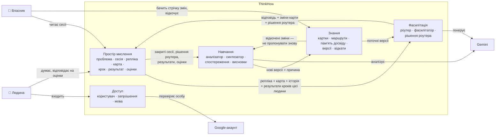
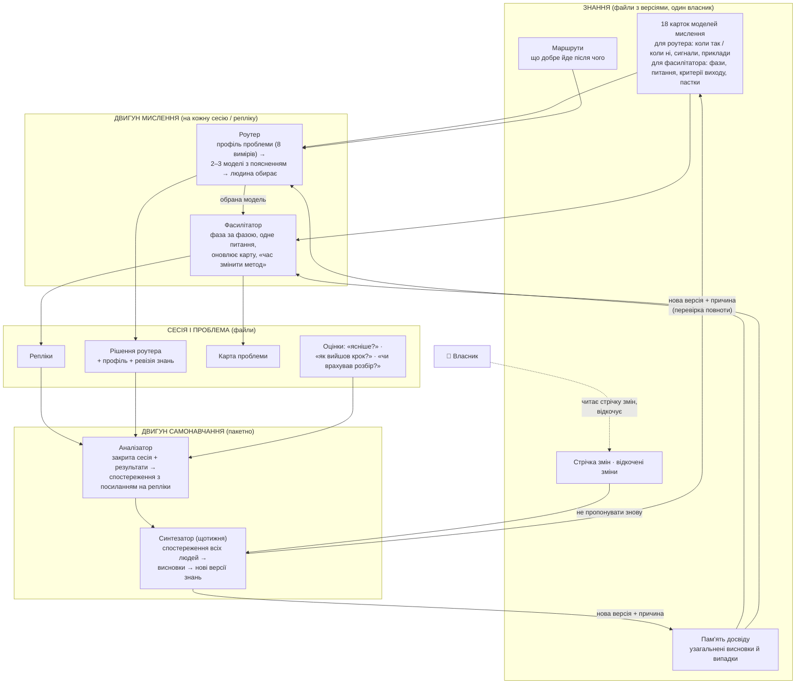

# Domain map — ThinkHow

Статус: M1 СХВАЛЕНО власником 2026-10-18 (редакція 4, master-critic PASS; цілі v2 запечатано)
Рамка продукту: `.engine/goals.md` v2 (G4, P3, D1, Q3 змінено поправкою від 2026-10-18,
запечатано власником).
Довідкові матеріали: `docs/research/01–03` — не рішення.

Рішення власника на огляді (2026-10-18, у розмові):
- Окремої «Безпеки», кризових перевірок і кризової зупинки **немає**. N3 — межа продукту
  (ThinkHow — для спокійного обдумування), не річ, яку будуємо. Запит 003 відкликано.
- Власник читає **всі** сесії. Ні позначок «можна подивитись», ні журналу переглядів (запит 001).
- Листів людям ThinkHow **не надсилає** (запит 002).
- Текст сесій пишеться **файлами**; складніше зберігання поки не рухаємо.
- «Чи шкодуєте» прибрано; замість нього три короткі питання (D1 v2, запит 004).
- Система **вчиться автоматично**: сама застосовує свої висновки — і до пам'яті досвіду, і до
  карток. Власник бачить кожну зміну з її джерелом і може відкотити; наперед не схвалює.
- Стартова бібліотека — **18 моделей** мислення; з часом — більше.

## Простими словами

ThinkHow — це п'ять частин:

1. **Доступ** — хто ти: вхід через Google, лише запрошені, твоя мова.
2. **Простір мислення** — твої проблеми. Кожна живе тижнями: сесії-розмови і **карта
   проблеми** (що розглянуто, що відкинуто й чому, чого бракує, емоції, обраний крок, на чому
   зупинились). Карта дає змогу повернутися через місяць і не переповідати (G2). Тут же кроки
   людини, їхні результати й короткі оцінки (D1).
3. **Фасилітація** — співрозмовник: роутер обирає модель мислення, фасилітатор веде по ній, не
   дає готових відповідей (N1).
4. **Знання** — 18 карток моделей мислення, маршрути між ними і пам'ять досвіду. Єдиний
   власник усіх версій: будь-яку зміну тут видно і можна відкотити.
5. **Навчання** — двигун самонавчання: сам аналізує сесії й результати кроків, робить висновки з
   посиланням на місце в сесії (G6) і через Знання змінює поведінку системи (G3).

## Context diagram

## Bounded contexts

### 1. Доступ
- Впускає лише запрошених (N2), особа — з Google (C3), мова людини (C4), роль `user` / `owner`.
  **Мову людина обирає сама** (при першому вході, змінити можна будь-коли; зберігає Простір мислення
  у `profile.json` — M3 A3.3); за нею закріплюється —
  на цю мову налаштоване розпізнавання голосу, і нею за замовчуванням відповідає фасилітатор
  (рішення власника 2026-10-18, після схвалення M1).
- Цілі: G4, C3, C4, N2.

### 2. Простір мислення — ядро продукту
- **Проблема** — ситуація, над якою людина думає тижнями (у G4 — «проєкт»); бачить лише ця
  людина і власник (G4 v2).
- **Сесія** — одна розмова в межах проблеми. **Закривається**, коли людина відповіла «чи стало
  ясніше?», або після 24 годин без реплік (технічне значення за замовчуванням, показується власникові в
  огляді). Кнопки «завершити» немає, і закриття не є умовою аналізу: нічне навчання бере всі нові з
  минулого прогону репліки, навіть розмови, що ще йде (рішення власника, задача 202). Закрита сесія не відкривається знову;
  продовження — нова сесія. Якщо сесію закрила тиша і «чи стало ясніше?» не відповіли, це питання
  ставлять, коли людина повертається, разом із «як вийшов крок?».
- **Репліка** — одне повідомлення в сесії, з номером, щоб на нього можна було послатися (G6).
  Людина може **надиктувати** репліку голосом: голос розпізнається закріпленою за нею мовою, текст
  з'являється в полі введення, людина його виправляє й надсилає. Записом розмови
  є текст; звук як дані ThinkHow не зберігає (технічний вибір; голос — вимога власника 2026-10-18).
- **Карта проблеми** — живий підсумок: розглянуті й відкинуті (з причиною) варіанти, чого
  бракує, сліпі плями, емоції — свої й іншої сторони (G5), обраний крок і чому, «що мало б
  статися, щоб передумати» (G1), на якій картці й фазі зупинились (G2). Кожен пункт — з
  посиланням на репліку.
- **Крок** — дія, яку людина сама обрала; **результат кроку** — вийшло / частково / не вийшло /
  несподіванка + коротко що сталось (G3).
- **Оцінки** (D1 v2), лише в застосунку:
  - наприкінці сесії — «чи стало ясніше, що робити далі?» (ясніше / так само / заплутаніше);
  - коли людина повертається до проблеми — «як вийшов крок?»;
  - якщо не вийшло чи несподіванка — «чи врахував це розбір?» (так, ми це бачили / ні,
    пропустили).
  Результат кроку й ці оцінки приходять через дні чи тижні після сесії. Навчання саме забирає
  такі сесії: його пакет бере нові репліки, результати чи оцінки, новіші за останнє
  спостереження (задача 202: не закриття) (Простір нічого в Навчання не штовхає).
- Зберігання: файлами (рішення власника; як саме — M2).
- Цілі: G1, G2, G4, G5, D1.

### 3. Фасилітація
- **Роутер** — будує профіль проблеми, пропонує 2–3 моделі з поясненням, людина обирає.
- **Фасилітатор** — веде по фазах обраної картки, одне питання за раз, без готових відповідей
  (N1), пропонує зміни карти, каже «час змінити метод».
- **Рішення роутера** — профіль проблеми (8 вимірів), кандидати, що обрано, хто обрав, чому, і
  **ревізію Знань**, з якою працював.
- Фасилітація нічого не зберігає сама: відповідь, зміни карти, рішення роутера, поточну картку й
  фазу вона повертає Простору мислення, і той зберігає їх разом із сесією. Навчання читає все
  лише з Простору.
- Читає Знання лише в поточних версіях; нічого в них не пише.
- Цілі: G1, G5, N1.

### 4. Знання — усе, що система знає і чого навчилась
- **Інваріант:** усе в Знаннях, що читає модель (картки з їхніми прикладами, маршрути, пам'ять
  досвіду), — узагальнене, без цитат і подробиць людей, бо це читається в розмовах з іншими
  людьми (G4: виняток лише для власника). Посилання на репліки (G6) — лише в частині, яку бачить
  власник. Цього ж вимагає контракт синтезатора.
- **Картка** — один слот бібліотеки: одна модель мислення або тісний набір (GROW / Backcasting,
  продуктовий набір — research 01 L1081–1108); половина для роутера (коли так / коли ні, сигнали,
  приклади — тут і всі «правила роутера») і половина для фасилітатора (фази, питання, критерії
  виходу, пастки).
- **Маршрут** — які картки добре йдуть одна за одною.
- **Пам'ять досвіду** — окремі записи узагальнених висновків і випадків, які роутер і фасилітатор
  читають у кожній сесії (G3); підлягає інваріанту вище.
- **Версія** — кожна застосована зміна будь-чого тут (і кожен відкат) змінює **ревізію Знань** і
  має причину (посилання на висновки Навчання). Рішення роутера записує ревізію — з нею можна
  відтворити, що бачила модель. (M2: ревізія — пара «номер останньої зміни, номер останнього
  відкату», бо зміни пише навчання, а відкати — власник.)
- **Мова Знань** — одна для всього вмісту (картки, пам'ять), бо люди пишуть різними мовами (C4);
  фасилітатор відповідає мовою людини. Яка саме — технічний вибір M3.
- **Перевірка версії** — **кожна** нова версія (картка чи запис пам'яті) стає поточною, лише якщо
  пройшла дві перевірки: (1) повнота — для картки: є фази, критерії виходу, правило «одне питання
  за раз»; (2) інваріант G4 — у частині, яку читає модель, немає посилань на репліки, цитат і
  подробиць людей. Не пройшла — не стає поточною і видна в стрічці як «відхилено перевіркою».
  Як саме перевіряти — рішення рівня функції (найдешевше: збіг тексту з репліками, на які
  посилається висновок, + один виклик моделі на версію). Це свідомо менше, ніж радить research 03
  L256 (прогін на regression set) — при ≤50 сесіях на тиждень такого набору не буде; решту
  компенсує стрічка змін і відкат.
- **Стрічка змін** — що змінилось, коли, чому, з посиланнями (G6). Власник читає її і може
  **відкотити** будь-яку зміну.
- **Відкат** повертає картку чи запис пам'яті до версії перед зміною; пізніші зміни того самого
  предмета відкочуються разом із нею. Записи пам'яті окремі, тож відкат одного не чіпає інших.
- **Відкочена зміна** — запис «цю зміну власник відкотив, причина». Синтезатор отримує ці записи
  (зміна + причина) і має не пропонувати те саме знову; це настанова моделі, не гарантія —
  повтор власник побачить у стрічці.
- Стартові 18 карток (рішення власника; шортлист research 01 L1083–1106): First Principles,
  MECE / Issue Trees, Cynefin, 5 Whys, Is / Is-Not, WRAP, зважена матриця вибору, One-Way /
  Two-Way Doors + 10/10/10, Evaporating Cloud, Pre-mortem, Consider-the-Opposite, сократівські
  питання, SCAMPER, WOOP, Gibbs, GROW / Backcasting, JTBD, продуктовий набір (OST, Assumption
  Mapping, RICE). Назви без торговельних марок (research 01 L293–308).
- Цілі: G1, G3, G5, G6.

### 5. Навчання — двигун самонавчання
- Читає закриті сесії, рішення роутера, результати кроків і оцінки; пише **спостереження** і
  **висновки** з посиланнями на репліки (G6); подає в Знання нові версії карток і пам'яті з
  причиною. Сам у файли Знань не пише — лише через Знання.
- Свої результати кроків людини з інших її проблем Фасилітація бачить напряму від Простору, без
  Навчання (G3 «в цій і в наступних проблемах»).
- Цілі: G3, G6.

## Ядро: як система думає і як вчиться

### Двигун мислення
- **Профіль проблеми** — 8 вимірів замість 11 з research 01 (L376–394): намір,
  структурованість, оборотність, ставки, стан даних, стан варіантів, емоційний стан, соціальний
  контекст (чи є інша сторона — для G5). Не беремо як окремі виміри: Cynefin (дублює
  структурованість), горизонт часу й експертизу/бажаний результат (видно з розмови; фасилітатор
  враховує дедлайн, якщо людина його називає). З першої
  розповіді (+1–2 уточнювальні питання, якщо не ясно) і з карти, якщо проблема вже не нова.
- **Роутер** — один виклик моделі (18 карток-для-роутера вміщуються в контекст — research 02
  L1216): профіль + 2–3 кандидати з поясненням → людина обирає або просить інше (research 02
  L396–403). Враховує пам'ять досвіду і результати кроків самої людини з інших її проблем.
- **Фасилітатор** — на кожну репліку: картка + фаза + карта + історія → відповідь з одним
  питанням, без готових відповідей (N1) + структуроване оновлення (фаза, зміни карти, «час змінити
  метод» — research 02 L1029–1033, спрощено). Один маршрут не плануємо наперед: одна картка,
  потім пропозиція наступної (research 01 L1199).
- Premise PR-02: роутер і фасилітатор — по одному виклику Gemini — PoC у M2.

### Двигун самонавчання (G3, G6)
Статистичні способи з research 03 (bandits, OPE, A/B) потребують 500+ сесій (L799) — у нас їх
не буде роками. Тому двигун — **якісний аналіз моделлю**, як «stage 0–1» research 03
(L254–264, L970–975):
1. **Сигнали** — з першого дня: рішення роутера (+ профіль + ревізія знань), пройдені фази й де
   людина кинула, прохання змінити метод, «чи стало ясніше», кроки й результати, «чи врахував це
   розбір». Останнє — головне для credit assignment: відділяє помилку методу від обставин
   (research 03 L202–226). «Ясніше» — сигнал, не мета: висновок не може спиратися лише на нього
   (інакше найпростіший шлях «покращення» — давати готові відповіді, проти N1 і P2); основа —
   результати кроків і «чи врахував це розбір».
2. **Аналізатор** — щоночі про нові репліки (задача 202, без закриття) і знову, коли прийшов результат її кроку: модель читає
   сесію з результатами і пише **спостереження** — що спрацювало чи ні, де саме (посилання на
   репліки), чия «вина»: вибору моделі, ведення розмови чи обставин.
3. **Синтезатор** (щотижня) — групує спостереження всіх людей за схожими ситуаціями (за профілем
   проблеми) у **висновки** і з них — **нові версії** пам'яті досвіду й карток. Може не лише
   додавати записи пам'яті, а й зливати чи замінювати старі, щоб пам'ять не росла без меж. Читає відкочені
   зміни і їх не повторює.
4. **Застосування — автоматично** (рішення власника): Знання приймає нову версію, якщо вона
   пройшла перевірку версії (повнота + без подробиць людей), і робить її поточною.
5. **Контроль** — власник читає стрічку змін (що, чому, з посиланнями) і відкочує те, що не
   подобається. Порівнювати «до / після» цифрами при ≤50 сесіях на тиждень — шум; тому
   ніяких дашбордів, контроль — стрічка змін.

## Ubiquitous language

| Термін | Значення | Не плутати з |
|---|---|---|
| проблема | ситуація людини, що живе тижнями | сесією |
| сесія | одна розмова в межах проблеми; межа — після 24 год тиші (кнопки «завершити» немає, аналіз від неї не залежить — задача 202) | проблемою |
| репліка | одне повідомлення в сесії, з номером | — |
| карта проблеми | живий підсумок проблеми з посиланнями на репліки | профілем проблеми |
| профіль проблеми | 8 вимірів ситуації для вибору моделі | картою проблеми |
| крок | дія людини в реальному світі | фазою картки |
| результат кроку | що сталося після кроку | — |
| оцінки | «чи стало ясніше?», «як вийшов крок?», «чи врахував це розбір?» (D1) | — |
| картка | одна модель мислення (половина для роутера, половина для фасилітатора) | — |
| фаза | етап усередині картки | кроком |
| маршрут | які картки добре йдуть одна за одною | — |
| рішення роутера | запис: профіль, кандидати, вибір, чому, ревізія знань | — |
| пам'ять досвіду | узагальнені висновки й випадки, які читають роутер і фасилітатор | — |
| версія / ревізія Знань | одна застосована зміна в Знаннях з причиною / стан Знань (M2: пара «остання зміна, останній відкат») | — |
| перевірка версії | повнота + «без подробиць людей»; без неї версія не стає поточною | — |
| стрічка змін | перелік версій для власника | — |
| відкочена зміна | версія, яку власник скасував; Навчання її не повторює | — |
| спостереження | знахідка аналізатора про одну сесію, з посиланням на репліки | — |
| висновок | узагальнення кількох спостережень, з посиланнями (G6) | — |

## Розглянуто й відкинуто

- **Частини з досліджень без «проблеми».** Жодне дослідження не має сутності, що живе тижнями;
  для G2 вона головна.
- **Не зберігати текст сесій** (research 01 L1297, 03 L382). Без тексту неможливі G2 і G6.
- **Окрема «Безпека» з кризовою перевіркою** (research 01/02). Відкинуто власником: ThinkHow —
  для спокійного обдумування, N3 — межа продукту.
- **Позначки «можна подивитись», журнал переглядів.** Відкинуто власником: власник читає все.
- **Оцінка жалю (research 03 DRS).** Відкинуто власником як надто «космічне» питання для
  щоденних рішень.
- **Оцінка «чи сподобалась сесія».** Відкинуто: G3 прямо каже вчитися з реальних результатів, а
  не з того, чи сподобалась сесія; такі оцінки на 85–90% позитивні (research 03 L171).
- **Зміни знань лише після схвалення власника.** Відкинуто власником: система вчиться
  автоматично; контроль — стрічка змін і відкат.
- **Пам'ять досвіду в Навчанні, картки в Бібліотеці — кожен зі своїми версіями.** Тоді два
  механізми версій і відкату, а стрічка змін розірвана між двома частинами; єдиний контроль
  власника (відкат) мусить діяти однаково на все, чого система навчилась.
- **Знання злити з Навчанням.** Менше частин, але межа між ними — межа приватності: у Навчанні
  спостереження з посиланнями на репліки й подробицями людей (бачить лише власник), у Знаннях —
  лише те, що модель читає в розмовах з іншими людьми (G4). Саме на цій межі стоїть перевірка
  версії. Крім того, різний ритм: Знання читають на кожній репліці, Навчання пише раз на тиждень.
- **Статистичне навчання (bandits, OPE, A/B — research 03).** Потребує 500+ сесій; у нас ≤50 на
  тиждень.

## Load-bearing premises
PR-01…PR-05, PR-07 у `.engine/premises/premise-log.md`. Найризиковіший — PR-02 (один виклик
Gemini в EU-регіоні веде фазу картки і повертає оновлення карти) — PoC у M2.

## Звірка з цілями
- служить: G1, G2, G3, G4, G5, G6, D1 (у редакції v2)
- вибір між варіантами розв'язав: P3 — зберігати текст сесій і власник читає все (вдосконалення
  понад приватність); автоматичне застосування висновків і 18 карток — рішення власника
  2026-10-18 (принципи їх не ранжують); один власник усіх версій знань — бо відкат має діяти
  однаково на все (G3 + рішення власника); решта меж — вибір технічний (за мовою, ритмом і
  причинами змін)
- не-цілі й обмеження: N1 — у Фасилітації; N2 — лише запрошені; N3 — межа продукту, нічого не
  будуємо (рішення власника); C3 — вхід через Google; C4 — мова людини; G4 — усі Знання, які
  читає модель, без цитат і подробиць людей (виняток G4 — лише для власника)
