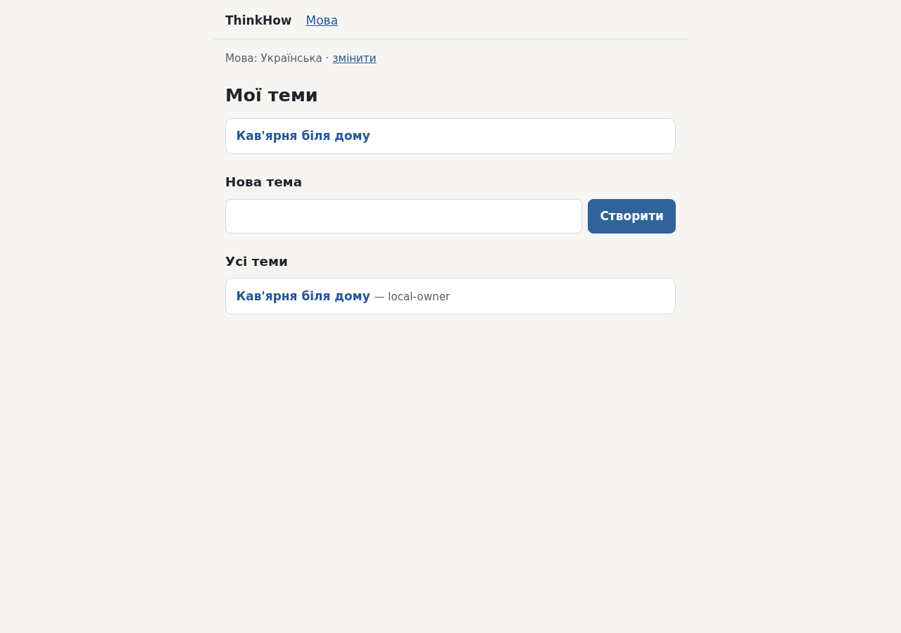
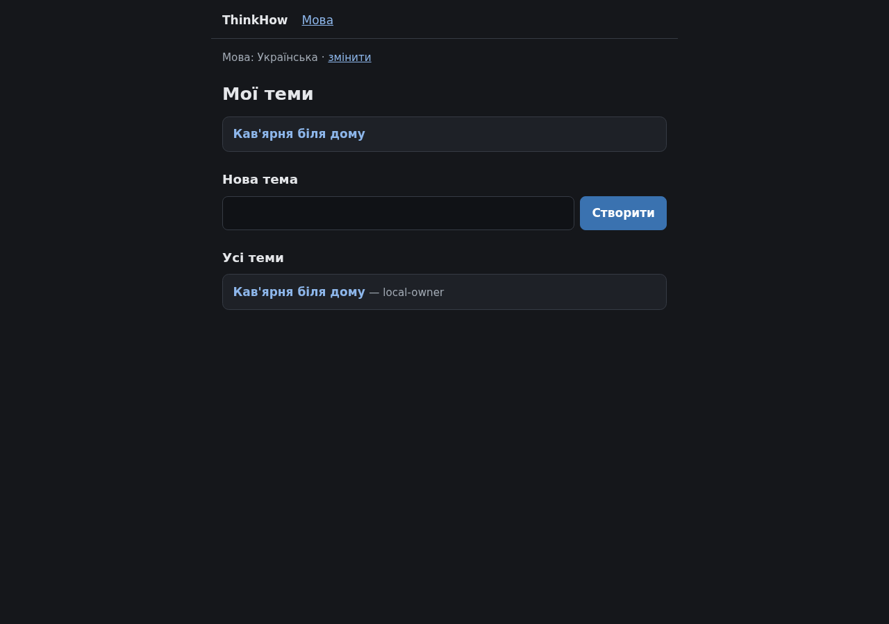
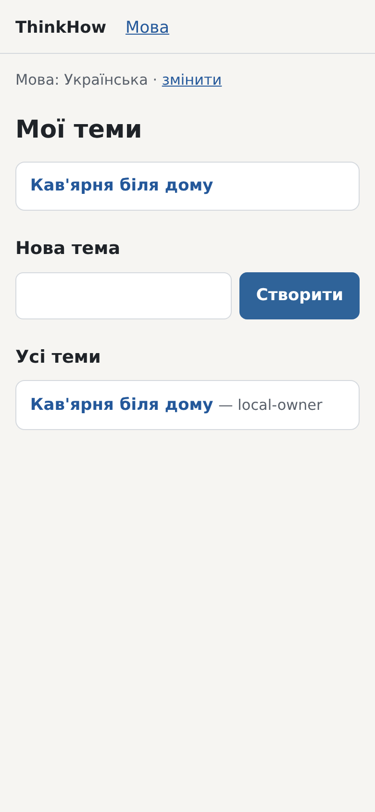
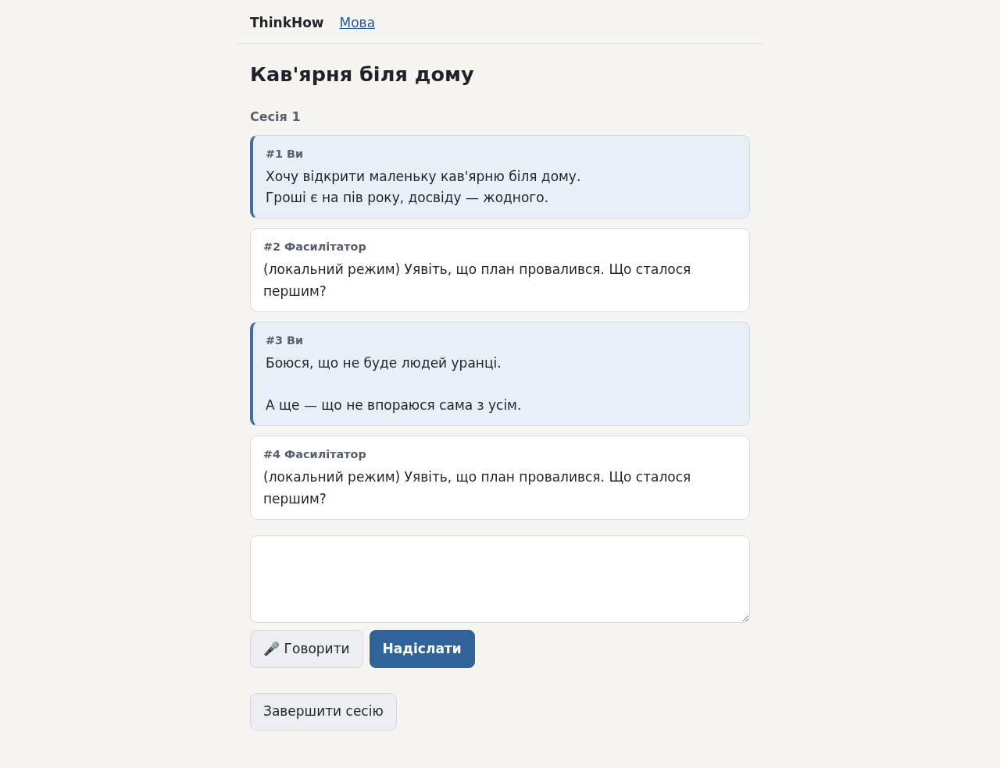
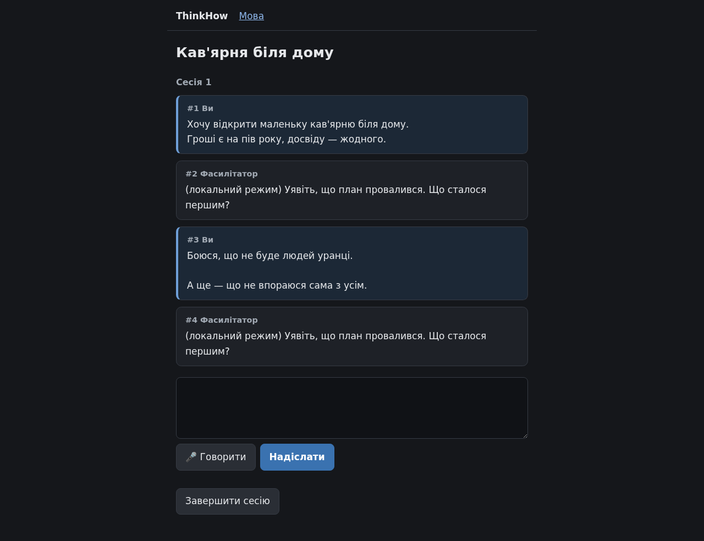
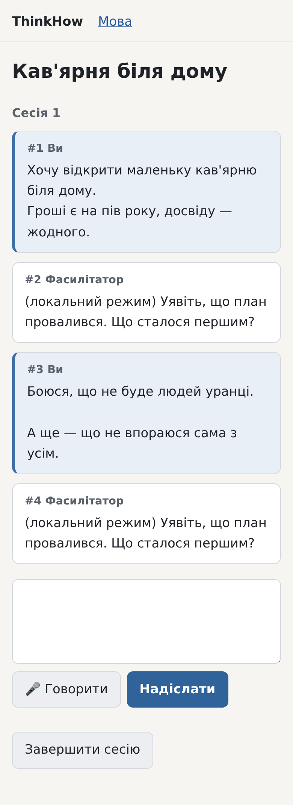
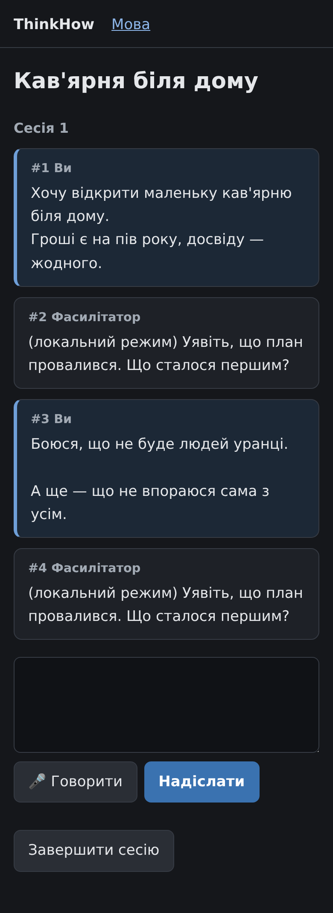
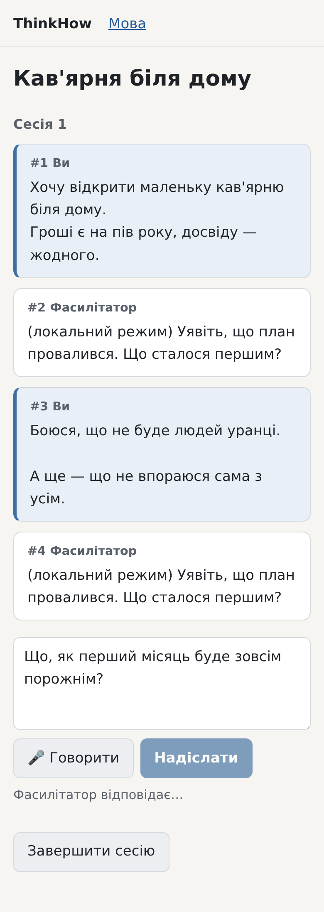

# Звіт — 201: мінімальний дизайн сторінок

## Що змінилось для власника
- У сторінок тепер простий охайний вигляд: спокійні кольори, системний шрифт, колонка тексту близько 42rem (зручна
  ширина рядка), помітне поле введення й головна кнопка («Надіслати», «Створити», «Зберегти» — синя).
- **Світла й темна тема** — вмикаються самі, за налаштуванням телефона чи комп'ютера; перемикача немає.
- **Репліки розрізняються:** ваші — на тонованому тлі зі смугою ліворуч, фасилітатора — на нейтральній картці; підписи
  «Ви» / «Фасилітатор» лишились.
- **Стан «відповідь іде»:** поки запит триває, кнопка «Надіслати» вимкнена, а поруч написано «Фасилітатор відповідає…».
  Текст відповіді, що надходить, теж підписано «Фасилітатор».
- **На телефоні** сторінки не розпираються вшир: це перевірено при ширині 390 і 360 px, також зі словом із 60 літер у
  назві теми й у репліці.
- Поведінка не змінилась: `conversation.js` не змінювався, SSE, збереження тексту в полі, мікрофон і IAP працюють як
  раніше. Одне свідоме виправлення: `autocomplete="off"` на кнопках «Надіслати» і «Спробуйте ще раз». За відомою
  поведінкою Firefox (Mozilla bug 654072) без цього атрибута кнопка після відповіді лишалася б вимкненою. У самому Firefox
  це **не перевірено**: його немає на машині.
- Попутно виправлено давню ваду: у збережених відповідях фасилітатора стояли зайві порожні рядки (стиль `pre-wrap` діяв на
  всю картку і показував переноси рядків самого шаблону).

## Знімки екрана
Зняті в справжньому Chromium скриптом `scripts/screenshots_minimal_design.py` (local mode). Запис пройдених перевірок —
`.engine/artifacts/spikes/minimal-design-screens-2026-10-23.txt`.

«Мої теми» · комп'ютер · світла тема

«Мої теми» · комп'ютер · темна тема

«Мої теми» · телефон · світла тема

«Мої теми» · телефон · темна тема

Тема з розмовою · комп'ютер · світла тема

Тема з розмовою · комп'ютер · темна тема

Тема з розмовою · телефон · світла тема

Тема з розмовою · телефон · темна тема

Тема · телефон · світла тема · стан «відповідь іде»: знято, поки запит `/reply` справді триває

## Демонстрація на хвилину
- Відкрийте знімки вище. Найкраще видно на `screens/topic-phone-dark.png` і `screens/topic-pending-phone-light.png`.
- Щоб відтворити: `uv run --with playwright==1.64.1 python scripts/screenshots_minimal_design.py --out /tmp/screens`.
  Скрипт сам запускає сервіс у local mode і друкує кроки. Наприкінці має бути рядок `OK: …`.
- На розгортанні: відкрийте будь-яку тему з телефона. Тема сторінки — та сама, що й тема телефона.

## Перевірки
- `uv run pytest` — 483 passed (було 456; нові 27 контрактних тестів у `tests/contract/minimal_design/` написав
  незалежний slice-tester); `uv run ruff check .`, `uv run mypy` — чисто.
- Запечатані тести попередніх slice-ів не змінені: `testing.py check` дає match для skel-web, voice-dictation,
  voice-language і voice-reply-language.
- Smoke-скрипти: `smoke_test_voice_dictation.py` (мікрофон → текст у полі → надіслати → відповідь),
  `smoke_test_skel_web.py`, `smoke_test_voice_language.py` — OK.
- Overseer: PASS (`OVERSEER_REQUEST 20261023T214029Z-d7501f`).

## Витрати
- Додаткових сесій Claude не було (`Додаткові сесії: ні`). Усередині цієї сесії працювали subagent-и: критики плану
  (9 прочитань), тестувальники (контрактні тести, catch-up, одне заперечення), testing manager (двічі) і overseer.
- Викликів Vertex AI не було: усе в local mode.

## Діапазон commit-ів
`0fee572` (задача → doing) … `399e8de` (код, тести, знімки) і commit, яким задачу перенесено в `done/`.

## Відкладене
- Перемикач теми на сторінці. Зараз тема йде за пристроєм. Варто робити, якщо хтось попросить іншу тему, ніж на пристрої.
- Markdown у відповідях фасилітатора (списки, жирний шрифт). Варто робити, коли в репліках моделі з'являться рядки, що
  починаються з `- ` чи `1. `.
- Перевірка `autocomplete="off"` у справжньому Firefox. Варто зробити, якщо побачите вимкнену «Надіслати» чи «Фасилітатор
  відповідає…» на сторінці з уже готовою відповіддю.
- Оголошення стану «відповідь іде» для читачів екрана (`aria-live`). Без змін у JS воно ненадійне.
- Сторінка помилки після звичайного POST форми без JS (наприклад, порожня назва теми) лишилась без стилю: це фрагмент
  `
`, на якому тримаються тести й JS.

## Рішення, які я ухвалив сам
- **Один власний `style.css` замість CSS-фреймворку** (Pico.css чи water.css): без нової залежності. Стиль однаково
  довелося б переписувати під репліки й стан «відповідь іде».
- **Тема за пристроєм** (`prefers-color-scheme`), без перемикача: нуль JS.
- **Стан «відповідь іде» лише в CSS:** рядок `#pending` стоїть одразу після «Надіслати» і видимий, поки вона вимкнена
  (`#send:disabled ~ #pending`). Цей селектор працює в усіх браузерах. Варіант із `:has()` (рядок під відповіддю)
  відкинув: його немає в старіших Firefox і Safari.
- **`autocomplete="off"`** на «Надіслати» і «Спробуйте ще раз» (див. вище). Двосторонні двері: прибрати атрибут — одна
  правка шаблону.
- **Репліки — блоки на всю ширину**, не «бульбашки» чату: довгі вдумливі тексти у вузьких бульбашках гірше читаються
  на телефоні.
- **Системні шрифти**, без вебшрифтів: жодного запиту за межі сервісу (він за IAP).
- **Поріг контрасту 4.5:1 (WCAG AA)** для всіх пар «текст / тло» в обох темах. Його перевіряє тест I2. Поріг тимчасовий
  (`PROVISIONAL`), до вашої відповіді нижче.

## Питання до власника
1. **Чи підходить вимога контрасту тексту 4.5:1 (стандарт WCAG AA) для обох тем?** Варіанти: (а) так — поріг лишається,
   тест I2 охороняє читабельність при майбутніх змінах кольорів; (б) ні, м'якше (наприклад, 3:1) — можна блідіші кольори,
   але дрібний сірий текст гірше читається на сонці; (в) прибрати вимогу — тоді прибираю один тест. **Раджу (а):** це
   загальний стандарт читабельності, і нинішні спокійні кольори його вже виконують (найнижчі пари — 5.49:1 у світлій темі, сірий підпис на тлі вашої репліки, і 4.98:1 у темній, білий
   текст на синій кнопці).
   Відповідь не блокує роботу: дизайн уже на місці.

   Відповідь:

## Які цілі вона просуває
Нової функції задача не будує. Це оформлення наявних сторінок за вашими словами в задачі 201 («треба хоч якийсь дизайн
придумати, хоч мінімальний»); окремого рядка в `.engine/goals.md` про вигляд сторінок немає.
